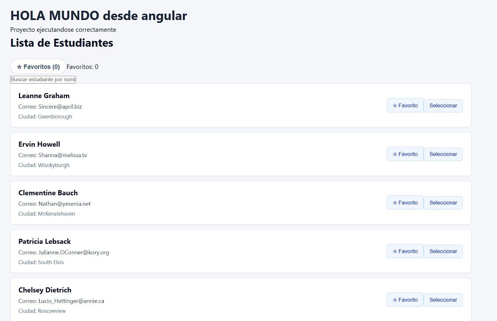
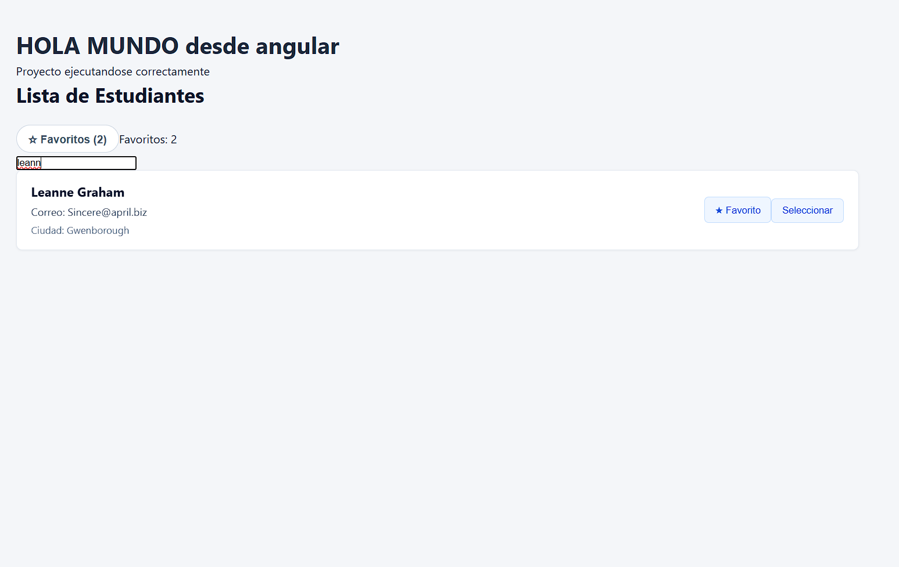
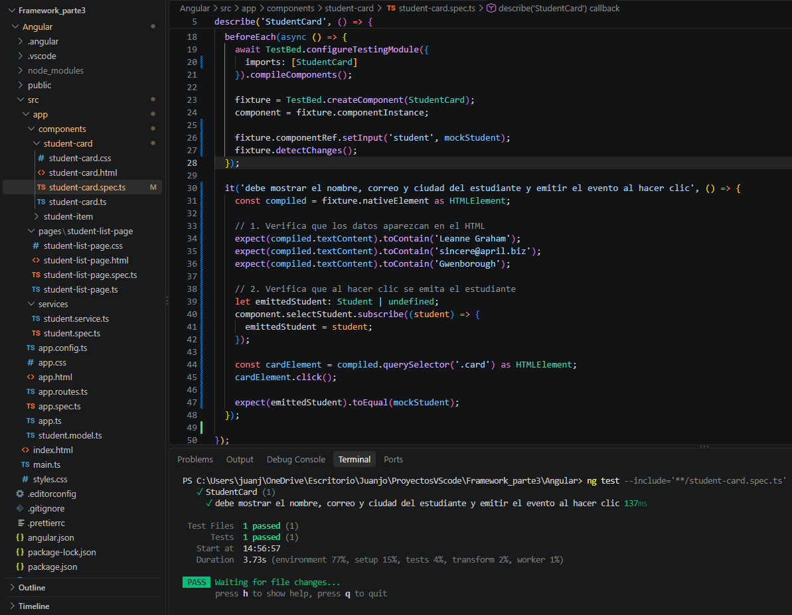
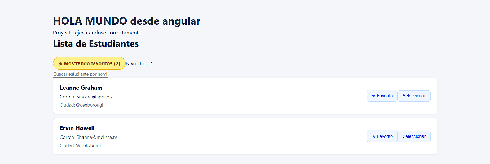

# Gestor de Estudiantes — Comparativa Angular vs. React
## Programado por: Juan José Abril

Aplicación web para la consulta, búsqueda por nombre, visualización de detalles y filtrado de favoritos de estudiantes consumiendo la API pública de JSONPlaceholder (`/users`), implementada utilizando el framework **Angular**.

---

## Angular

### Comandos de ejecución y pruebas

1. Entrar a la carpeta del proyecto Angular e instalar las dependencias:
   ```bash
   cd Angular
   npm install
   ```

2. Levantar el servidor de desarrollo:
   ```bash
   ng serve -o
   ```

3. Ejecutar las pruebas unitarias:
   ```bash
   ng test --include='**/student-card.spec.ts' 
   ```

---


## Evidencias

# Funcionamiento de la aplicación



# Funcionamiento de la barra de busqueda


# Prueba realizada


# Funcionalidad adcional (Filtro para favoritos)

