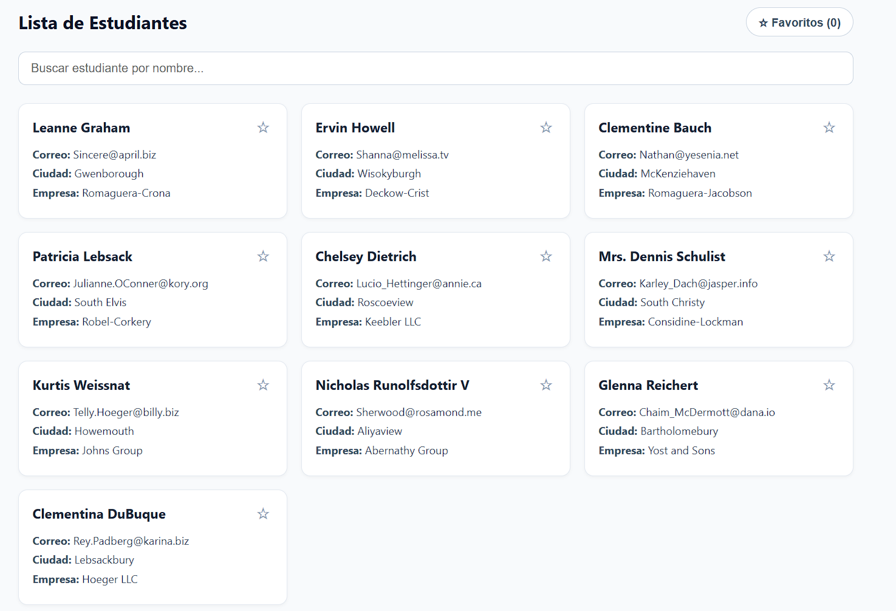
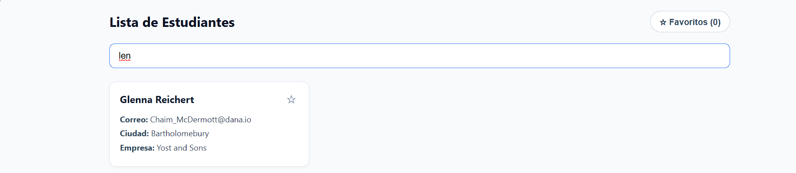
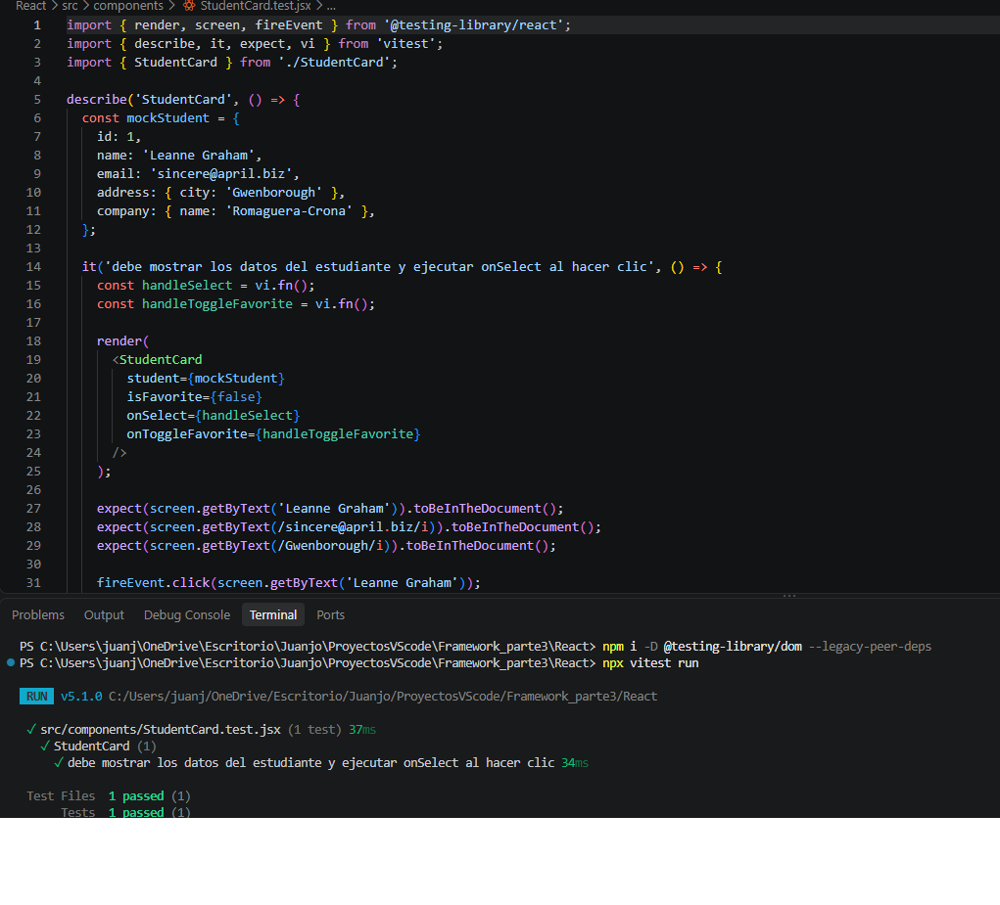
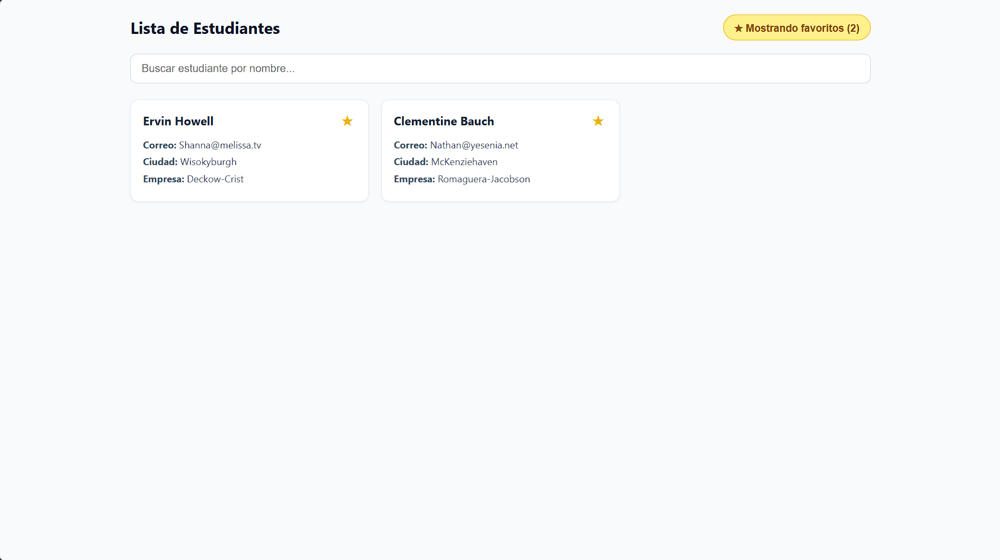

# Gestor de Estudiantes — Comparativa Angular vs. React
## Programado por: Juan José Abril

Aplicación web para la consulta, búsqueda por nombre, visualización de detalles y filtrado de favoritos de estudiantes consumiendo la API pública de JSONPlaceholder (`/users`), implementada utilizando el framework **React**.

### Comandos de ejecución y pruebas

1. Entrar a la carpeta del proyecto React e instalar las dependencias:
   ```bash
   cd React
   npm install
   ```

2. Levantar el servidor de desarrollo con Vite :
   ```bash
   npm run dev
   ```

3. Ejecutar las pruebas unitarias con Vitest:
   ```bash
   npx vitest run
   ```

---

## Evidencias

# Interfaz de la aplicación



# Funcionamiento de la barra de busqueda



# Prueba realizada


# Funcionalidad adcional (Filtro para favoritos)
